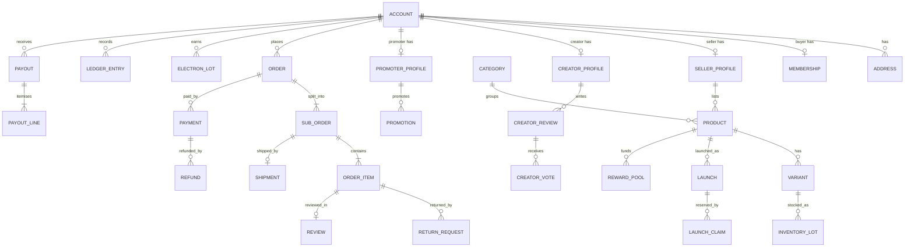
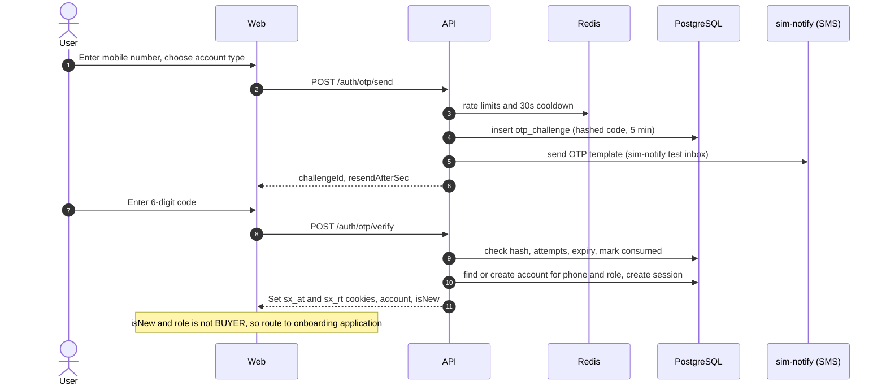
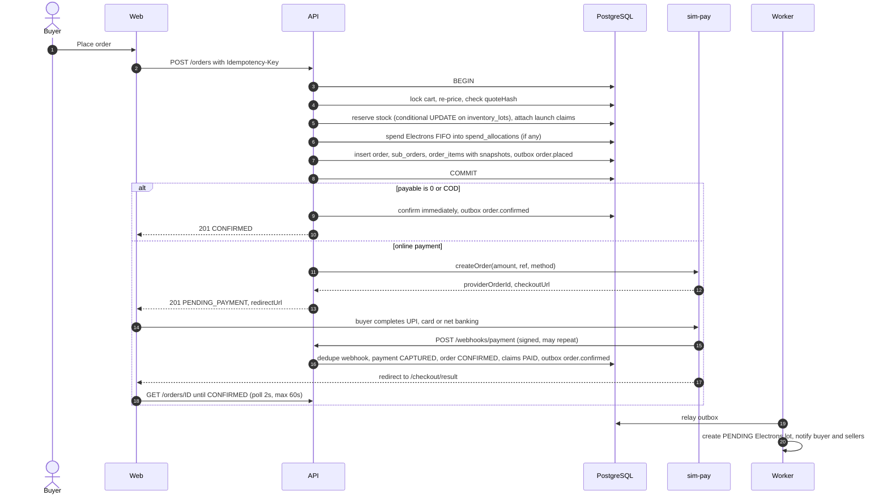
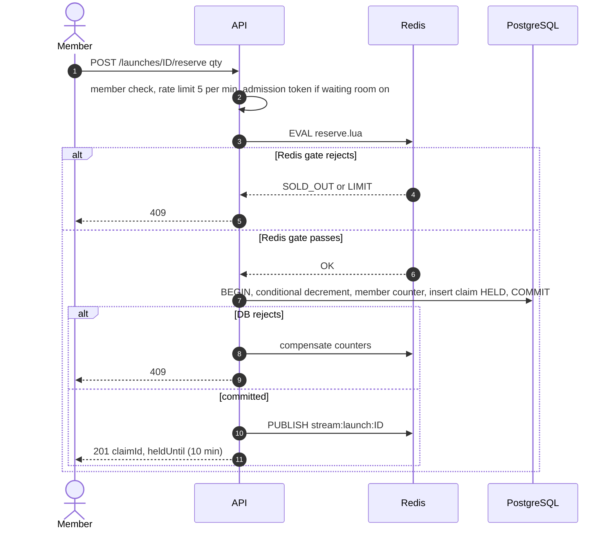
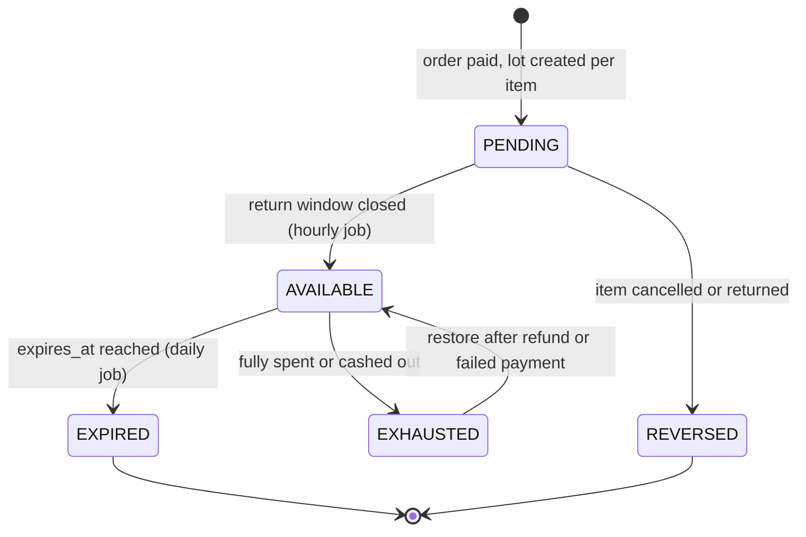
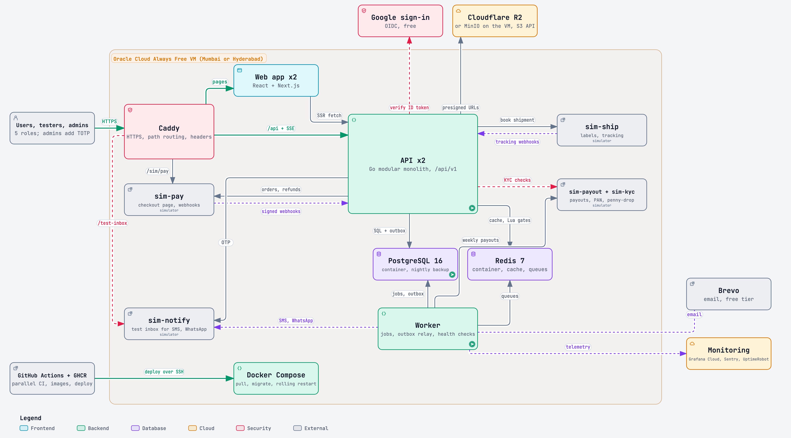

# Siliconics: Low-Level Design (LLD)

| | |
|---|---|
| **Version** | 1.2 (Draft), 24 Nov 2026 |
| **Implements** | Technical Requirements Specification v1.3 (TRS), Business Requirements Document v1.2 (BRD) |
| **Readers** | Developers, QA, DevOps, tech lead, project manager |
| **Scope** | End-to-end design of v1: web app, API, worker, data, integrations (simulated), jobs, infra, tests |
| **Hosting** | v1 is a **prototype on free services only** (TRS D-20 to D-24). Everything here is free to run and test. Paid providers and paid hosting are planned separately in [`paid-later/`](../paid-later/README.md) and are not part of this build. |

> IDs like `FR-LAU-07`, `NFR-CAP-02`, `D-11`, `A-06`, `Q-02` refer to the TRS. This document says **how** they are built. The free services this build uses are listed in [free-services.md](free-services.md); the team's working rules are in [dev-workflow.md](dev-workflow.md).

**Diagrams** (exported from the interactive versions in `.archify/`):
[Prototype architecture](design/siliconics-prototype-architecture-free-tier.png) ·
[Checkout and payment](design/lld-checkout-and-payment.png) ·
[Launch deal reservation](design/lld-launch-deal-reservation-never-oversell.png) ·
[Sub-order lifecycle](design/lld-sub-order-lifecycle-per-seller-shipment.png) ·
[Electrons lot lifecycle](design/lld-electrons-lot-lifecycle.png) ·
[Core data model](design/lld-core-data-model-postgresql.png) ·
[Front-end architecture](design/ui/frontend-architecture.png) (UI page structures and flows: section 14)

---

## 1. Conventions

| Topic | Rule |
|---|---|
| IDs | UUIDv7 (time-ordered) for all primary keys. Human-facing numbers: orders `SX-YYMMDD-NNNNNN`, invoices `<SELLERCODE>/<FY>/<seq>`. |
| Money | `bigint` **paise**. Never floats. Display formatting only in the web app (`₹1,20,000`). |
| Electrons | `int`, whole units. 1 Electron = 100 paise. |
| Percentages | Basis points (`bps`): 80% = 8000, 4% = 400, 0.5% = 50. |
| Time | `timestamptz` in UTC. Schedules are defined in IST (`Asia/Kolkata`). |
| Naming | snake_case in SQL and JSON; Go packages are lower-case singular; TS uses camelCase via the generated client. |
| Soft delete | Only accounts (status `DELETED` + PII scrub). Everything else is immutable or status-driven. |
| Synthetic data | Every business table that health checks touch has `is_synthetic boolean NOT NULL DEFAULT false`; all reports, jobs and counters filter `is_synthetic = false`. |

---

## 2. Runtime components

| Component | Tech | Port | Responsibility | Copies on the VM |
|---|---|---|---|---|
| `web` | Next.js 15 (React 19, App Router), TypeScript | 3000 | SSR/ISR pages, role-based UI, BFF cookie forwarding | 2 (1 GB each) |
| `api` | Go 1.23, chi, pgx, sqlc | 8080 | REST API `/api/v1`, webhooks, SSE streams | 2 (1 GB each) |
| `worker` | Go, asynq | — | Outbox relay, notifications, scheduled jobs, payouts, synthetic checks | 1 |
| `sim-pay` | Go + small HTML UI | 9001 | Simulated payment gateway (hosted checkout, webhooks, refunds, mandates) | 1 |
| `sim-ship` | Go | 9002 | Simulated shipping aggregator (serviceability, AWB, labels, tracking webhooks) | 1 |
| `sim-payout` | Go | 9003 | Simulated bank payouts | 1 |
| `sim-kyc` | Go | 9004 | Simulated PAN check and penny-drop | 1 |
| `sim-notify` | Go | 9005 | Test inbox for SMS and WhatsApp (and email locally), searchable by phone number (FR-NOT-05) | 1 |
| PostgreSQL 16 | Container | 5432 | System of record | 1 |
| Redis 7 | Container | 6379 | Cache, rate limits, launch gates, queues, SSE fan-out | 1 |
| Object storage | Cloudflare R2 free or MinIO container (S3 API) | — | Images, documents (KYC bucket separate, encrypted), invoices | 1 (MinIO) |

All services are stateless; the only state is in PostgreSQL, Redis and object storage. Everything runs on one free VM (section 17.1).

---

## 3. Repository layout (monorepo)

```
siliconics/
├─ apps/web/                      # Next.js
│  ├─ app/(public)/ (buyer)/ (seller)/ (creator)/ (promoter)/ (admin)/
│  ├─ components/ (ui/, product/, checkout/, launch/, status/)
│  ├─ lib/ (api-client, auth, i18n, format, flags)
│  └─ messages/en.json            # all UI text (A-01)
├─ services/api/
│  ├─ cmd/api  cmd/worker  cmd/migrate  cmd/seed
│  ├─ internal/
│  │  ├─ auth  account  catalogue  pdp  cart  checkout  payment  order  shipping
│  │  ├─ returns  issue  membership  launch  electrons  review  creator  promoter
│  │  ├─ seller  payout  discovery  notify  admin  health  report  legal
│  │  │     └─ each: handler.go  service.go  repo.go (sqlc)  model.go  events.go  *_test.go
│  │  ├─ platform/ (db, redis, config, httpx, authn, authz, idempotency, ratelimit,
│  │  │             outbox, jobs, money, clock, audit, otel, storage, crypto)
│  │  └─ provider/ (payment, shipping, payout, kyc, sms, whatsapp, email, oauth)
│  │                 └─ each: interface.go  sim/  (real adapters added later)
│  └─ api/openapi.yaml            # source of truth for the HTTP contract
├─ services/simulators/ (pay, ship, payout, kyc, notify)
├─ db/ (migrations/, queries/, seed/)
├─ packages/api-client/           # generated from openapi.yaml
├─ infra/prototype/ (docker-compose.yml, Caddyfile, bootstrap.sh, backup scripts)
└─ tests/ (e2e/ Playwright, load/ k6, contract/)
```

**Module rules:** `handler → service → repo`. A module may call another module only through its `service` interface (no cross-module SQL). Side effects that cross modules (notifications, Electrons, payouts) are triggered by **domain events through the outbox**, not direct calls, except inside one DB transaction where a synchronous service call is required (e.g. checkout holding Electrons).

---

## 4. Cross-cutting design

### 4.1 HTTP middleware order (api)
`RequestID → Recover → OTel trace + structured log → SecurityHeaders → CORS → RealIP → RateLimit → Session (authn) → ActingRole → AuthZ guard → Idempotency (mutating routes that need it) → Handler`

### 4.2 Authentication
| Item | Design |
|---|---|
| OTP | `otp_challenges(id, phone, role, code_hash, attempts, sends, expires_at, consumed_at)`. Code = 6 random digits; stored as `HMAC-SHA256(pepper, phone‖role‖code)`. Valid 5 min, 5 attempts, resend after 30 s, 3 sends / phone / 15 min (FR-AUTH-02). Delivered through the SMS adapter; in this build it lands in the sim-notify test inbox. |
| Google | OIDC Authorization Code + PKCE. `state` and `nonce` in a signed, short-lived cookie that also carries the chosen `role`. On callback, look up `(google_sub, role)`; create if new. New Google accounts get `phone_verified_at = NULL` → blocked from checkout and role applications until `/me/phone/verify` (A-04). |
| Multiple role accounts | If a phone/Google identity matches more than one role account and no role was chosen, return `409 ROLE_CHOICE_REQUIRED` with the list; UI shows a picker (FR-ROLE-03). |
| Tokens | `sx_at`: EdDSA-signed JWT, 15 min, claims `sub, role, sid, act` (acting role, admins only), `HttpOnly; Secure; SameSite=Lax; Path=/`. `sx_rt`: opaque 256-bit, 30 days, stored hashed in `sessions` with `family_id`; rotated on each refresh; reuse of an old token revokes the whole family (FR-AUTH-05). |
| Admin | TOTP (RFC 6238) required after OTP; `sessions.mfa_at` must be set; idle timeout 30 min enforced on refresh (FR-AUTH-06). |
| CSRF | SameSite=Lax + double-submit token header `X-CSRF-Token` on all mutating requests from the browser. |

### 4.3 Authorization
- Policy table in code: `permission → allowed roles` (mirrors the TRS permission matrix). Guards: `RequireRole(...)`, `RequireApproved()`, `RequireMember()`, `RequireOwner(resource)`.
- **Admin role switch** (FR-ROLE-07/08): `POST /admin/role-switch {role}` sets `act` in a fresh access token. While `act` is set, guards evaluate as that role, every write is audit-logged with `acting_as_role`, and a deny-list blocks: payout approval/release, cash-out, approvals, KYC submission. Orders created while switched are forced `is_synthetic = true` and paid only via the simulator.

### 4.4 Transactions, outbox and events
- Every business write runs in one `pgx.Tx`. Domain events are inserted into `outbox(id, topic, key, payload jsonb, created_at, published_at)` **in the same transaction**.
- `worker` relays outbox rows (`FOR UPDATE SKIP LOCKED`, batches of 200) to asynq queues. Consumers are idempotent via `processed_events(consumer, event_id)` PK.
- Core topics: `order.placed`, `order.confirmed`, `order.expired`, `suborder.status_changed`, `suborder.delivered`, `return.status_changed`, `refund.completed`, `membership.activated|renewed|lapsed`, `launch.status_changed`, `electrons.lot_available|expiring`, `review.published`, `creator_vote.cast`, `account.approval_changed`, `payout.paid|failed`, `health.check_failed`.

### 4.5 Idempotency
`idempotency_keys(key, account_id, route, request_hash, status_code, response jsonb, created_at)`, PK `(account_id, route, key)`, TTL 24 h (daily purge). Same key + same hash → replay stored response. Same key + different hash → `422 IDEMPOTENCY_CONFLICT`. Required on: `POST /orders`, `POST /launches/:id/reserve`, `POST /membership/purchase`, `POST /creator/cashouts`, refunds, payout release.

### 4.6 Errors (RFC 9457)
```json
{ "type": "https://siliconics.in/errors/launch-sold-out", "title": "All items on discount were purchased",
  "status": 409, "code": "LAUNCH_SOLD_OUT", "requestId": "01J…", "detail": "…" }
```
| Code | HTTP | Code | HTTP |
|---|---|---|---|
| `VALIDATION_FAILED` | 400 | `LAUNCH_NOT_LIVE` | 409 |
| `AUTH_REQUIRED` / `AUTH_OTP_INVALID` / `AUTH_OTP_EXPIRED` | 401 | `LAUNCH_SOLD_OUT` / `LAUNCH_LIMIT_REACHED` | 409 |
| `FORBIDDEN_ROLE` / `NOT_APPROVED` / `MEMBERSHIP_REQUIRED` | 403 | `LAUNCH_QUEUE_REQUIRED` | 428 |
| `NOT_FOUND` | 404 | `COD_NOT_ELIGIBLE` / `ELECTRONS_INSUFFICIENT` | 422 |
| `ROLE_CHOICE_REQUIRED` / `VERSION_CONFLICT` | 409 | `RETURN_WINDOW_CLOSED` / `CASHOUT_BELOW_MIN` / `KYC_REQUIRED` | 422 |
| `STOCK_INSUFFICIENT` / `PRICE_CHANGED` | 409 | `ADMIN_LIMIT_REACHED` | 422 |
| `IDEMPOTENCY_CONFLICT` | 422 | `RATE_LIMITED` (+ `Retry-After`) | 429 |
| `PAYMENT_FAILED` | 402 | `PROVIDER_UNAVAILABLE` | 503 |

### 4.7 Configuration (admin-editable, FR-ADM-03)
`config(key, value jsonb, version, updated_by, updated_at)` + `config_history`. Cached in Redis (`cfg:all`, 60 s) and in-process (30 s). Values that affect money are **snapshotted onto the order/launch at creation**, so later changes never alter past orders (FR-REW-09).

| Key | Default | Key | Default |
|---|---|---|---|
| `membership.fee_paise` | 65000 | `electrons.expiry_months` | 12 |
| `electrons.nonmember.min_paise` / `.rate_bps` | 250000 / 50 | `electrons.expiry_reminder_days` | [30, 7] |
| `electrons.member.min_paise` / `.rate_bps` | 80000 / 200 | `returns.window_days` | 7 |
| `cod.max_order_paise` | 800000 (exclusive) | `cashout.min_electrons` | 250 |
| `launch.deal_discount_bps` / `.min_profit_bps` | 8000 / 400 | `creator.min_followers` | 5000 |
| `launch.hold_minutes` | 10 | `creator.pool.weights` | [1.0, 0.75, 0.5, 0.25] |
| `checkout.hold_minutes` | 10 | `creator.pool.default_size` | Q-02 (0 until set) |
| `verified_tag.threshold_paise` | 40000000 | `pow.weights` | `{units: 0.6, rating: 0.4}` |
| `ratelimit.*` | per TRS 8.5 | `refund.reissue_expiry_days` | 30 |

`categories.commission_bps` and `categories.gst_rate_bps` live on the category (Q-01).

**Deployment settings (environment variables, not admin-editable).** These pick the provider adapter, so every outside service in this build is free ([free-services.md](free-services.md)):

| Variable | Value in this build |
|---|---|
| `PROVIDER_PAYMENT` / `PROVIDER_SHIPPING` / `PROVIDER_PAYOUT` / `PROVIDER_KYC` | `sim` |
| `PROVIDER_SMS` / `PROVIDER_WHATSAPP` | `sim` (test inbox) |
| `PROVIDER_EMAIL` | `brevo` (`log` locally) |
| `STORAGE_ENDPOINT`, `STORAGE_BUCKET_*` | R2 or MinIO (S3 API) |
| `ENCRYPTION_MASTER_KEY` | secret on the VM |
| `FEATURE_TEST_INBOX` | `true` (password `TEST_INBOX_PASSWORD`) |
| `OTEL_EXPORTER_OTLP_ENDPOINT`, `SENTRY_DSN` | Grafana Cloud free, Sentry free |
| `APP_MODE` | `prototype` (a later `production` mode refuses to start while any provider is `sim` or the test inbox is on) |

---

## 5. Data model

### 5.1 Core relationships



### 5.2 Critical tables (DDL)

```sql
-- Accounts & sessions ------------------------------------------------------
CREATE TYPE account_role AS ENUM ('BUYER','SELLER','PROMOTER','CREATOR','ADMIN');
CREATE TYPE approval_status AS ENUM ('DRAFT','SUBMITTED','UNDER_REVIEW','APPROVED','REJECTED','SUSPENDED');

CREATE TABLE accounts (
  id               uuid PRIMARY KEY,
  role             account_role NOT NULL,
  phone_e164       text,                       -- +91XXXXXXXXXX (A-03)
  phone_verified_at timestamptz,
  google_sub       text,
  email            citext,
  name             text NOT NULL,
  status           text NOT NULL DEFAULT 'ACTIVE' CHECK (status IN ('ACTIVE','SUSPENDED','DELETED')),
  approval         approval_status NOT NULL,   -- BUYER/ADMIN start APPROVED, others DRAFT
  approval_reason  text,
  totp_secret_enc  bytea,                      -- admins only (app-level envelope encryption)
  is_synthetic     boolean NOT NULL DEFAULT false,
  created_at       timestamptz NOT NULL DEFAULT now(),
  version          int NOT NULL DEFAULT 1
);
CREATE UNIQUE INDEX ux_acc_phone_role  ON accounts(phone_e164, role) WHERE phone_e164 IS NOT NULL AND status <> 'DELETED';
CREATE UNIQUE INDEX ux_acc_google_role ON accounts(google_sub, role) WHERE google_sub IS NOT NULL AND status <> 'DELETED';
-- trigger trg_admin_limit: BEFORE INSERT/UPDATE when role='ADMIN' AND status='ACTIVE':
--   pg_advisory_xact_lock(hashtext('admin_limit')); IF count(active admins) >= 3 THEN RAISE 'ADMIN_LIMIT_REACHED' (FR-ROLE-06)

CREATE TABLE sessions (
  id uuid PRIMARY KEY, account_id uuid NOT NULL REFERENCES accounts, family_id uuid NOT NULL,
  refresh_hash bytea NOT NULL UNIQUE, user_agent text, ip inet, mfa_at timestamptz,
  last_used_at timestamptz NOT NULL, expires_at timestamptz NOT NULL, revoked_at timestamptz
);

-- Catalogue & stock --------------------------------------------------------
CREATE TABLE products (
  id uuid PRIMARY KEY, seller_id uuid NOT NULL REFERENCES seller_profiles(account_id),
  category_id uuid NOT NULL REFERENCES categories, slug text UNIQUE NOT NULL,
  name text NOT NULL, model text NOT NULL, brand text NOT NULL, specs jsonb NOT NULL,
  description text NOT NULL, warranty text NOT NULL, origin_country char(2) NOT NULL,
  is_local boolean NOT NULL DEFAULT false, is_launch_exclusive boolean NOT NULL DEFAULT false,
  status text NOT NULL CHECK (status IN ('DRAFT','ACTIVE','PAUSED','HIDDEN')),
  search tsvector GENERATED ALWAYS AS (to_tsvector('english', name||' '||model||' '||brand)) STORED,
  rating_avg numeric(3,2) NOT NULL DEFAULT 0, rating_count int NOT NULL DEFAULT 0,
  is_synthetic boolean NOT NULL DEFAULT false, created_at timestamptz NOT NULL DEFAULT now(), version int NOT NULL DEFAULT 1
);
CREATE INDEX ix_products_search ON products USING gin(search);
CREATE INDEX ix_products_name_trgm ON products USING gin(name gin_trgm_ops);

CREATE TABLE variants (
  id uuid PRIMARY KEY, product_id uuid NOT NULL REFERENCES products, sku text UNIQUE NOT NULL,
  attrs jsonb NOT NULL DEFAULT '{}', mrp_paise bigint NOT NULL, price_paise bigint NOT NULL,
  CHECK (price_paise > 0 AND price_paise <= mrp_paise)
);

CREATE TYPE lot_kind AS ENUM ('SELLER','LAUNCH_NORMAL');   -- deal units are tracked on launches
CREATE TABLE inventory_lots (
  id uuid PRIMARY KEY, variant_id uuid NOT NULL REFERENCES variants,
  owner_seller_id uuid NOT NULL,                 -- platform seller for launch stock (D-10)
  kind lot_kind NOT NULL, launch_id uuid REFERENCES launches,
  quantity int NOT NULL, reserved int NOT NULL DEFAULT 0, sold int NOT NULL DEFAULT 0,
  unit_cost_paise bigint,                        -- set for launch stock
  CHECK (quantity >= 0 AND reserved >= 0 AND sold >= 0 AND reserved + sold <= quantity)
);

-- Launch deals ---------------------------------------------------------------
CREATE TYPE launch_status AS ENUM ('DRAFT','SCHEDULED','LIVE','DEAL_SOLD_OUT','NORMAL_ON_SALE','COMPLETED','CANCELLED');
CREATE TABLE launches (
  id uuid PRIMARY KEY, product_id uuid NOT NULL REFERENCES products, variant_id uuid NOT NULL REFERENCES variants,
  seller_id uuid NOT NULL,
  units_bought int NOT NULL CHECK (units_bought > 0),
  unit_cost_paise bigint NOT NULL CHECK (unit_cost_paise > 0),
  normal_price_paise bigint NOT NULL,
  deal_discount_bps int NOT NULL, deal_price_paise bigint NOT NULL,
  min_profit_bps int NOT NULL,
  deal_units int NOT NULL CHECK (deal_units BETWEEN 1 AND units_bought),
  deal_remaining int NOT NULL CHECK (deal_remaining BETWEEN 0 AND deal_units),   -- never oversell (FR-LAU-07)
  per_member_limit int NOT NULL CHECK (per_member_limit >= 1),                    -- seller-set (D-12)
  starts_at timestamptz NOT NULL,
  normal_sale_mode text NOT NULL CHECK (normal_sale_mode IN ('IMMEDIATE','SCHEDULED')),  -- A-09
  normal_sale_at timestamptz,
  waiting_room_rps int,                           -- NULL = off (FR-LAU-11)
  status launch_status NOT NULL DEFAULT 'DRAFT',
  seller_invoice_doc uuid, created_by uuid NOT NULL, created_at timestamptz NOT NULL DEFAULT now(), version int NOT NULL DEFAULT 1
);
CREATE TABLE launch_member_counters (
  launch_id uuid REFERENCES launches, account_id uuid REFERENCES accounts,
  claimed int NOT NULL DEFAULT 0 CHECK (claimed >= 0), PRIMARY KEY (launch_id, account_id)
);
CREATE TABLE launch_claims (
  id uuid PRIMARY KEY, launch_id uuid NOT NULL, account_id uuid NOT NULL, qty int NOT NULL CHECK (qty > 0),
  status text NOT NULL CHECK (status IN ('HELD','ORDERED','PAID','RELEASED')),
  order_id uuid, held_until timestamptz NOT NULL, created_at timestamptz NOT NULL DEFAULT now()
);
CREATE INDEX ix_claims_expiry ON launch_claims(held_until) WHERE status IN ('HELD','ORDERED');

-- Orders --------------------------------------------------------------------
CREATE TYPE pay_method AS ENUM ('UPI','CARD','NETBANKING','COD','ELECTRONS_ONLY');
CREATE TABLE orders (
  id uuid PRIMARY KEY, number text UNIQUE NOT NULL, buyer_id uuid NOT NULL REFERENCES accounts,
  address jsonb NOT NULL,                         -- snapshot
  status text NOT NULL CHECK (status IN ('PENDING_PAYMENT','CONFIRMED','EXPIRED','CLOSED')),
  item_total_paise bigint NOT NULL, shipping_paise bigint NOT NULL DEFAULT 0,
  electrons_used int NOT NULL DEFAULT 0, payable_paise bigint NOT NULL,
  pay_method pay_method NOT NULL, is_member_at_order boolean NOT NULL, contains_launch_deal boolean NOT NULL,
  rules_snapshot jsonb NOT NULL,                  -- earn rates, thresholds, COD limit at order time
  expires_at timestamptz NOT NULL, placed_at timestamptz NOT NULL DEFAULT now(),
  is_synthetic boolean NOT NULL DEFAULT false
);
CREATE TYPE sub_status AS ENUM ('PENDING_PAYMENT','CONFIRMED','PACKED','SHIPPED','OUT_FOR_DELIVERY','DELIVERED','EXPIRED','CANCELLED','RTO');
CREATE TABLE sub_orders (
  id uuid PRIMARY KEY, order_id uuid NOT NULL REFERENCES orders, seller_id uuid NOT NULL,
  status sub_status NOT NULL, invoice_no text UNIQUE, delivered_at timestamptz,
  return_window_ends_at timestamptz, settled_at timestamptz,  -- settled = included in payout
  version int NOT NULL DEFAULT 1
);
CREATE TABLE order_items (
  id uuid PRIMARY KEY, sub_order_id uuid NOT NULL REFERENCES sub_orders, variant_id uuid NOT NULL,
  price_type text NOT NULL CHECK (price_type IN ('NORMAL','LAUNCH_DEAL','LAUNCH_NORMAL')),
  launch_id uuid, lot_id uuid, launch_claim_id uuid,
  qty int NOT NULL CHECK (qty > 0), unit_mrp_paise bigint NOT NULL, unit_price_paise bigint NOT NULL,
  line_total_paise bigint NOT NULL, gst_rate_bps int NOT NULL, commission_bps int NOT NULL,
  electrons_spent int NOT NULL DEFAULT 0,          -- share of order.electrons_used
  electrons_earned int NOT NULL DEFAULT 0,         -- share of earned Electrons (for exact reversal)
  status text NOT NULL DEFAULT 'ACTIVE' CHECK (status IN ('ACTIVE','CANCELLED','RETURNED','REPLACED'))
);

-- Payments ------------------------------------------------------------------
CREATE TABLE payments (
  id uuid PRIMARY KEY, purpose text NOT NULL CHECK (purpose IN ('ORDER','MEMBERSHIP','RENEWAL')),
  order_id uuid, membership_id uuid, provider text NOT NULL, provider_order_id text UNIQUE,
  provider_payment_id text UNIQUE, method pay_method NOT NULL, amount_paise bigint NOT NULL,
  status text NOT NULL CHECK (status IN ('CREATED','PENDING','CAPTURED','FAILED','EXPIRED')),
  failure_code text, captured_at timestamptz, created_at timestamptz NOT NULL DEFAULT now()
);
CREATE TABLE refunds (
  id uuid PRIMARY KEY, payment_id uuid REFERENCES payments, order_item_id uuid,
  amount_paise bigint NOT NULL, electrons int NOT NULL DEFAULT 0,
  status text NOT NULL CHECK (status IN ('REQUESTED','PROCESSING','REFUNDED','FAILED')),
  provider_refund_id text UNIQUE, reason text, created_at timestamptz NOT NULL DEFAULT now()
);
CREATE TABLE webhook_events (provider text, event_id text, received_at timestamptz NOT NULL DEFAULT now(),
  payload jsonb NOT NULL, processed_at timestamptz, PRIMARY KEY (provider, event_id));

-- Electrons ledger -----------------------------------------------------------
CREATE TYPE lot_status AS ENUM ('PENDING','AVAILABLE','EXHAUSTED','EXPIRED','REVERSED');
CREATE TABLE electron_lots (
  id uuid PRIMARY KEY, account_id uuid NOT NULL REFERENCES accounts,
  source text NOT NULL CHECK (source IN ('PURCHASE','CREATOR_POOL','PROMOTER','REFUND_REISSUE','ADJUSTMENT')),
  source_ref uuid NOT NULL,                       -- order_item / pool_settlement / etc.
  amount int NOT NULL CHECK (amount > 0),
  remaining int NOT NULL CHECK (remaining BETWEEN 0 AND amount),
  status lot_status NOT NULL, available_at timestamptz, expires_at timestamptz,
  is_synthetic boolean NOT NULL DEFAULT false, created_at timestamptz NOT NULL DEFAULT now()
);
CREATE INDEX ix_lots_fifo ON electron_lots(account_id, expires_at) WHERE status = 'AVAILABLE' AND remaining > 0;
CREATE INDEX ix_lots_mature ON electron_lots(available_at) WHERE status = 'PENDING' AND available_at IS NOT NULL;

CREATE TABLE ledger_entries (                     -- append-only: app role has INSERT/SELECT only
  id uuid PRIMARY KEY, account_id uuid NOT NULL,
  type text NOT NULL CHECK (type IN ('EARN_PURCHASE','EARN_CREATOR_POOL','EARN_PROMOTER','MATURE',
        'SPEND_ORDER','SPEND_MEMBERSHIP','RESTORE','REVERSAL','EXPIRY','CASHOUT_HOLD','CASHOUT_PAID',
        'CASHOUT_RELEASE','ADMIN_ADJUSTMENT')),
  amount int NOT NULL,                            -- signed; EARN on PENDING lots does not change "available"
  lot_id uuid, ref_type text NOT NULL, ref_id uuid NOT NULL,
  actor_id uuid, note text, created_at timestamptz NOT NULL DEFAULT now()
);
CREATE TABLE spend_allocations (ledger_entry_id uuid, lot_id uuid, amount int CHECK (amount > 0),
  PRIMARY KEY (ledger_entry_id, lot_id));

-- Payouts ---------------------------------------------------------------------
CREATE TABLE payouts (
  id uuid PRIMARY KEY, batch_id uuid NOT NULL, beneficiary_id uuid NOT NULL,
  kind text NOT NULL CHECK (kind IN ('SELLER','CREATOR_CASHOUT','PROMOTER')),
  gross_paise bigint NOT NULL, commission_paise bigint NOT NULL DEFAULT 0, tds_paise bigint NOT NULL DEFAULT 0,
  adjustments_paise bigint NOT NULL DEFAULT 0, net_paise bigint NOT NULL,
  status text NOT NULL CHECK (status IN ('DRAFT','APPROVED','PROCESSING','PAID','FAILED')),
  provider_ref text, bank_ref text, failure_reason text, approved_by uuid, created_at timestamptz NOT NULL DEFAULT now()
);
CREATE TABLE payout_lines (payout_id uuid REFERENCES payouts, ref_type text, ref_id uuid, amount_paise bigint,
  PRIMARY KEY (payout_id, ref_type, ref_id));
CREATE TABLE cashout_requests (id uuid PRIMARY KEY, creator_id uuid NOT NULL, electrons int NOT NULL CHECK (electrons >= 250),
  status text NOT NULL CHECK (status IN ('REQUESTED','IN_BATCH','PAID','FAILED','CANCELLED')),
  payout_id uuid, ledger_hold_id uuid NOT NULL, created_at timestamptz NOT NULL DEFAULT now());
```

### 5.3 Other tables (columns abbreviated)

| Table | Key columns |
|---|---|
| `otp_challenges` | id, phone, role, code_hash, attempts, sends, last_sent_at, expires_at, consumed_at |
| `addresses` | id, account_id, name, phone, line1, line2, city, state, pincode, is_default |
| `memberships` | id, account_id UNIQUE, status (ACTIVE/LAPSED/CANCELLED), started_at, expires_at, auto_renew, mandate_id, renew_attempts |
| `mandates` | id, account_id, provider_ref, method (UPI_AUTOPAY/CARD_SI), max_amount_paise, status, revoked_at |
| `seller_profiles` | account_id PK, business_type, legal_name, code (invoice prefix), pan_enc, gstin, bank_enc, ifsc, pickup_address jsonb, is_platform, verified_tag, rolling_12m_sales_paise, about jsonb (links) |
| `creator_profiles` / `creator_socials` | account_id PK, niche, terms_version; platform, url, followers, evidence_doc, last_active_on, check_passed |
| `promoter_profiles` / `promoter_investments` | account_id PK, type (INDIVIDUAL/COMPANY), company jsonb; id, promoter_id, seller_id, proof_doc, admin_verified_at, seller_confirmed_at |
| `promotions` | promoter_id, product_id, created_at — PK (promoter_id, product_id) |
| `promoter_reward_rules` | product_id, promoter_id NULL (=all), type (ELECTRONS_PER_UNIT/PROFIT_SHARE_BPS), value |
| `kyc_records` | id, account_id, type (PAN/BANK), status, provider_ref, name_match, checked_at |
| `documents` | id, owner_id, purpose, s3_key, content_type, size, sha256, encrypted, uploaded_at |
| `categories` | id, parent_id, slug, name, spec_schema jsonb, commission_bps, gst_rate_bps, hsn |
| `product_images` | product_id, position, s3_key, alt |
| `carts` / `cart_items` | id, account_id NULL, device_id NULL; cart_id, variant_id, qty, added_at |
| `wishlist_items` | account_id, variant_id, notify_stock, notify_price, price_at_add |
| `shipments` / `tracking_events` | id, sub_order_id, kind (FORWARD/RETURN/DEMO), provider, awb UNIQUE, status, eta, cod_amount_paise, label_doc; shipment_id, status, location, at, raw |
| `return_requests` | id, order_item_id, type (RETURN/REPLACE), reason, photos uuid[], status, decided_by, pickup_shipment_id, replacement_sub_order_id |
| `issues` / `issue_messages` | id, buyer_id, order_id, order_item_id, type, status, assignee_id, first_response_at, resolved_at; issue_id, author_id, body, attachments |
| `reviews` / `review_photos` / `helpful_votes` | id, order_item_id UNIQUE, product_id, rating 1–5, body, status (PENDING/PUBLISHED/HIDDEN); … ; review_id, account_id PK |
| `creator_reviews` | id, creator_id, product_id, rating, body, media jsonb, published_at, rank, status — UNIQUE(creator_id, product_id) |
| `creator_votes` | creator_review_id, buyer_id, value (+1/−1), verified (buyer has delivered purchase), updated_at — PK(review, buyer) |
| `demo_requests` | id, creator_id, product_id, status (REQUESTED/APPROVED/DECLINED/SHIPPED/DELIVERED/REVIEWED/OVERDUE), shipment_id, due_at |
| `reward_pools` / `pool_settlements` | product_id, period (YYYY-MM), size, weights, funded_by; pool_id, creator_id, verified_agrees, weight, score, share, lot_id |
| `product_feedback` | id, product_id, buyer_id, category, body, seller_reply, replied_at |
| `products_of_week` | week_start, product_id, rank, score |
| `notifications` / `notification_prefs` | id, account_id, channel, template, payload, status, provider_ref, read_at; account_id, channel, marketing_opt_in |
| `legal_docs` / `legal_acceptances` | id, kind, version, body_md, published_at; account_id, doc_id, accepted_at, ip |
| `audit_log` | id, actor_id, acting_as_role, action, target_type, target_id, before, after, ip, at (append-only) |
| `ledger_adjustment_requests` | id, account_id, amount, reason, requested_by, approved_by (must differ) |
| `synthetic_runs` | id, check, ok, latency_ms, error, started_at |
| `outbox`, `processed_events`, `idempotency_keys`, `webhook_events`, `config`, `config_history` | see section 4 |

**Retention jobs:** OTP challenges 24 h, idempotency 24 h, sessions 30 days after expiry, notifications 180 days, synthetic data 7 days, audit and financial records 8 years (≥ 72 months GST rule).

---

## 6. Redis design

| Key | Type | TTL | Purpose |
|---|---|---|---|
| `cfg:all` | string (JSON) | 60 s | Config cache |
| `sess:deny:<sid>` | string | 15 min | Revoked session deny-list (access tokens still valid ≤ 15 min) |
| `rl:<group>:<subject>:<window>` | string counter | window | Fixed/sliding window rate limits |
| `otp:cool:<phone>` | string | 30 s | Resend cooldown |
| `pdp:<productId>` | hash | 60 s | Cached product read model (invalidated on product events) |
| `home:v1` | string | 120 s | Home page sections |
| `launch:<id>:remaining` | int | until completed | Fast gate for deal units (DB is source of truth) |
| `launch:<id>:member:<accountId>` | int | until completed | Fast per-member counter |
| `launch:<id>:queue` | zset (score = join time) | 2 h | Waiting room queue |
| `launch:<id>:admit` | int | 2 h | Admission cursor |
| `stream:launch:<id>` | pub/sub | — | SSE fan-out of remaining units / status |
| `stream:notif:<accountId>` | pub/sub | — | In-app notification push |
| `asynq:*` | asynq | — | Job queues: `critical` (payments, webhooks), `default`, `notifications`, `low` (reports, recs) |
| `lock:<job>` | string (SET NX PX) | job length | Single-runner lock for scheduled jobs |

On launch start, and on worker boot, `launch:*` counters are **rebuilt from PostgreSQL** (`deal_remaining`, `launch_member_counters`).

---

## 7. API specification (`/api/v1`)

Auth column: **G** guest, **B** buyer, **M** member, **S** seller, **C** creator, **P** promoter, **A** admin, **W** webhook (signed). `*` = `Idempotency-Key` required. All lists are cursor-paginated (`?cursor=&limit=`).

### 7.1 Auth & account
| Method | Path | Auth | Notes |
|---|---|---|---|
| POST | `/auth/otp/send` | G | `{phone, role}` → `{challengeId, resendAfterSec}` |
| POST | `/auth/otp/verify` | G | `{challengeId, code}` → sets cookies, `{account, isNew}` |
| GET | `/auth/google/start?role=` | G | 302 to Google |
| GET | `/auth/google/callback` | G | Sets cookies, 302 to app |
| POST | `/auth/totp/verify` | A | `{code}` → marks session MFA |
| POST | `/auth/refresh` · `/auth/logout` | any | Rotate / revoke |
| GET · PATCH · DELETE | `/me` | any | Profile; DELETE = deletion request (FR-AUTH-08) |
| POST | `/me/phone/otp` · `/me/phone/verify` | any | Phone verification for Google accounts |
| CRUD | `/me/addresses[/:id]` | B | PIN validated against serviceability table |
| GET · DELETE | `/me/sessions[/:id]` | any | Active sessions |
| GET · PUT | `/me/notification-prefs` | any | Channel opt-ins |
| GET | `/me/notifications` · `/me/notifications/stream` (SSE) | any | In-app bell |
| POST | `/uploads/presign` | any | `{purpose, contentType, size}` → S3 presigned PUT (max 10 MB, images/PDF only) |

### 7.2 Catalogue, product page, reviews
| Method | Path | Auth | Notes |
|---|---|---|---|
| GET | `/home` | G | Sections (FR-DIS-01); personalised block if signed in |
| GET | `/categories` | G | Tree |
| GET | `/products` | G | `q, category, priceMin, priceMax, brand, rating, local, inStock, launch, sort` |
| GET | `/products/:slug` | G | Static product data (cacheable) |
| GET | `/products/:id/live` | G | Price, stock, launch state, Electrons preview, **viewer actions** by role |
| GET | `/products/:id/similar` | G | FR-DIS-04 |
| GET | `/products/:id/reviews?type=buyer\|creator&sort=` | G | Paginated (10) |
| GET | `/products/:id/promoters` | G | "Promoted by" |
| POST | `/order-items/:id/review` · PATCH `/reviews/:id` | B | Only DELIVERED items (FR-REV-01) |
| POST | `/reviews/:id/helpful` · `/reviews/:id/report` | B | |
| PUT | `/creator-reviews/:id/vote` | B | `{value: 1\|-1\|0}`; server sets `verified` |
| POST | `/products/:id/feedback` | B | Private to seller (FR-REV-05) |

### 7.3 Cart, checkout, orders, payments
| Method | Path | Auth | Notes |
|---|---|---|---|
| GET | `/cart` | G/B | Guest cart keyed by `sx_dev` cookie |
| PUT · DELETE | `/cart/items/:variantId` | G/B | `{qty}` |
| POST | `/cart/merge` | B | After sign-in (FR-AUTH-09) |
| CRUD | `/wishlist/:variantId` | B | |
| POST | `/checkout/quote` | B | `{addressId, electrons, payMethod, launchClaimIds[]}` → totals, `codEligible`, `earnPreview`, price-change flags |
| POST | `/orders` * | B | Places order (section 8.3) → `{orderId, number, status, payment: {redirectUrl}\|null}` |
| GET | `/orders` · `/orders/:id` | B | Timeline, shipments, invoices |
| POST | `/sub-orders/:id/cancel` | B | Before SHIPPED |
| GET | `/invoices/:subOrderId.pdf` | B/S | Signed S3 URL |
| POST | `/webhooks/payment` | W | HMAC verified (section 12) |

### 7.4 Returns & issues
| Method | Path | Auth | Notes |
|---|---|---|---|
| POST | `/order-items/:id/returns` | B | `{type: RETURN\|REPLACE, reason, photoIds[]}`; ≤ 7 days after delivery |
| GET | `/returns[/:id]` | B | |
| POST | `/issues` | B | `{orderId, orderItemId?, type, body, photoIds[]}` (3-step UI) |
| GET | `/issues[/:id]` · POST `/issues/:id/messages` · POST `/issues/:id/reopen` | B | |

### 7.5 Membership, launches, Electrons
| Method | Path | Auth | Notes |
|---|---|---|---|
| GET | `/membership` | B | Status, expiry, auto-renew, next charge date |
| POST | `/membership/purchase` * | B | `{electrons, autoRenew}` → payment redirect or activated |
| PATCH | `/membership` | B | `{autoRenew: false}` revokes mandate (FR-MEM-04) |
| POST | `/membership/renew` * | M | Manual renew (money/Electrons) |
| GET | `/launches?status=` · `/launches/:id` | G | Public launch info, countdown |
| GET | `/launches/:id/stream` | G | SSE: `{status, dealRemaining, held}` every ≤ 1 s |
| POST | `/launches/:id/alerts` | B | Opt-in to start alert |
| POST | `/launches/:id/queue` | M | Join waiting room → `{ticket, position}` |
| GET | `/launches/:id/queue/:ticket` | M | `{position, admissionToken?}` |
| POST | `/launches/:id/reserve` * | M | `{qty, admissionToken?}` → `{claimId, heldUntil}` (section 8.4) |
| DELETE | `/launch-claims/:id` | M | Release early |
| GET | `/electrons` | B/C/P | `{available, pending, nextExpiry: {amount, at}}` |
| GET | `/electrons/ledger` | B/C/P | History with refs |

### 7.6 Creator, promoter, seller
| Method | Path | Auth | Notes |
|---|---|---|---|
| POST | `/creator/application` | C | Socials, evidence, terms version → SUBMITTED |
| POST | `/creator/demo-requests` · GET | C | `{productId}` |
| POST | `/creator/reviews` · PATCH `/creator/reviews/:id` | C | One per product; `published_at` sets rank |
| GET | `/creator/earnings` | C | Per product, per period |
| POST | `/creator/kyc` | C | PAN + bank → sim-kyc |
| POST | `/creator/cashouts` * · GET | C | `{electrons ≥ 250}` (section 8.10) |
| POST | `/promoter/application` · `/promoter/investments` | P | Proof doc, startup seller |
| PUT · DELETE | `/promoter/products/:id/promotion` | P | Only for confirmed startups |
| GET | `/promoter/dashboard` | P | |
| POST | `/seller/application` · PATCH `/seller/company` | S | KYC docs, PAN, GSTIN, bank |
| CRUD | `/seller/products[/:id]`, `/seller/products/:id/variants`, `/seller/products/:id/images` | S | |
| PATCH | `/seller/variants/:id/inventory` | S | Optimistic lock (`version`) |
| GET | `/seller/orders?status=` | S | |
| POST | `/seller/sub-orders/:id/pack` · `/ship` | S | `ship` books shipment → AWB + label |
| GET · POST | `/seller/returns[/:id/decision]` | S | |
| GET · POST | `/seller/demo-requests[/:id/decision]` | S | |
| GET · POST | `/seller/promoters[/:id/confirm]` | S | |
| PUT | `/seller/products/:id/promoter-reward` | S | Rule (FR-PRO-04) |
| GET · POST | `/seller/feedback[/:id/reply]` | S | |
| GET | `/seller/dashboard` · `/seller/payouts[/:id]` | S | Statements CSV/PDF |

### 7.7 Admin
| Method | Path | Notes |
|---|---|---|
| POST | `/admin/role-switch` | `{role\|null}` |
| GET · POST | `/admin/approvals?type=` · `/admin/approvals/:accountId/decision` | `{decision, reason}` |
| POST | `/admin/launches/calculate` | Pure calculation preview (section 9.1) |
| CRUD | `/admin/launches[/:id]` + POST `/schedule`, `/cancel`, `/open-normal-sale` | |
| GET | `/admin/launches/:id/live` | Held, sold, remaining, queue length |
| GET · POST | `/admin/users[/:id/suspend\|reactivate]` · `/admin/admins` (create, ≤ 3) | |
| GET · PATCH | `/admin/orders`, `/admin/issues/:id`, `/admin/returns/:id` | Assign, notes, decisions |
| GET · POST | `/admin/payout-batches[/:id/approve\|release]` | |
| GET · PUT | `/admin/config[/:key]` | Versioned |
| CRUD | `/admin/categories`, `/admin/legal-docs`, `/admin/reward-pools` | |
| POST | `/admin/products/:id/hide` · `/admin/reviews/:id/moderate` | |
| POST | `/admin/ledger-adjustments` · `/:id/approve` | Second admin approves |
| GET | `/admin/reports/:name?from&to&format=csv` | sales, commission, launch-pnl, electrons-liability, memberships, rewards |
| GET | `/admin/health` · `/admin/health/runs` · `/admin/audit` | |

### 7.8 Webhooks & probes
`POST /webhooks/{payment|shipping|payout|kyc}` (W) · `GET /healthz` (liveness) · `GET /readyz` (DB + Redis reachable).

**Example: place order**
```http
POST /api/v1/orders
Idempotency-Key: 6f1c…   X-CSRF-Token: …
{ "addressId": "…", "payMethod": "UPI", "electrons": 2000, "launchClaimIds": [], "quoteHash": "sha256:…" }
→ 201 { "orderId": "…", "number": "SX-261123-000184", "status": "PENDING_PAYMENT",
        "payableInr": "1,18,000", "payment": { "redirectUrl": "https://pay.sim.siliconics.in/checkout/po_…" } }
```
`quoteHash` lets the server detect that prices/stock changed since `/checkout/quote` → `409 PRICE_CHANGED`.

---

## 8. Core flows

### 8.1 Phone OTP sign-in / sign-up


### 8.2 Google sign-in
`/auth/google/start?role=X` → PKCE + `state` cookie → Google → `/auth/google/callback` → verify ID token (iss, aud, exp, nonce) → find/create `(google_sub, role)` → session cookies → if `phone_verified_at` is null, the web app shows a "verify mobile" step before checkout or applications.

### 8.3 Checkout and payment

**Reservation release:** sweeper every 30 s: orders `PENDING_PAYMENT` with `expires_at < now()` → `EXPIRED`, release `inventory_lots.reserved`, release launch claims, restore Electrons (`RESTORE` entries back to original lots; lots already expired are re-issued as `REFUND_REISSUE` expiring in `refund.reissue_expiry_days`). A late `CAPTURED` webhook for an expired order triggers an automatic full refund.

**Stock reservation SQL**
```sql
UPDATE inventory_lots SET reserved = reserved + $qty
 WHERE id = $lot AND quantity - reserved - sold >= $qty
RETURNING id;   -- 0 rows → STOCK_INSUFFICIENT
```
Lot choice per variant: `LAUNCH_NORMAL` lots first while a launch is in `NORMAL_ON_SALE`, otherwise `SELLER` lots.

### 8.4 Launch deal reservation (never oversell)

```lua
-- reserve.lua  KEYS[1]=launch:<id>:remaining  KEYS[2]=launch:<id>:member:<acc>  ARGV[1]=qty ARGV[2]=limit
local rem = tonumber(redis.call('GET', KEYS[1]) or '0')
local mine = tonumber(redis.call('GET', KEYS[2]) or '0')
local q, lim = tonumber(ARGV[1]), tonumber(ARGV[2])
if rem < q then return 'SOLD_OUT' end
if mine + q > lim then return 'LIMIT' end
redis.call('DECRBY', KEYS[1], q); redis.call('INCRBY', KEYS[2], q)
return 'OK'
```
```sql
-- inside one transaction (source of truth)
UPDATE launches SET deal_remaining = deal_remaining - $q
 WHERE id = $id AND status = 'LIVE' AND deal_remaining >= $q;            -- 0 rows → SOLD_OUT
INSERT INTO launch_member_counters(launch_id, account_id) VALUES ($id, $acc) ON CONFLICT DO NOTHING;
UPDATE launch_member_counters SET claimed = claimed + $q
 WHERE launch_id = $id AND account_id = $acc AND claimed + $q <= $limit; -- 0 rows → LIMIT (rollback)
INSERT INTO launch_claims(id, launch_id, account_id, qty, status, held_until) VALUES (…, 'HELD', now() + interval '10 minutes');
```
- Claim lifecycle: `HELD → ORDERED` (attached to an order; hold extended to the order's `expires_at`) `→ PAID`, or `→ RELEASED` by the sweeper / cancel / payment failure (both counters restored in DB and Redis).
- Display rules (FR-LAU-08): `deal_remaining = 0 AND held = 0` → **"All items on discount were purchased"**, Buy/Add to cart disabled. `deal_remaining = 0 AND held > 0` → "All discounted units are reserved; some may free up in a few minutes."
- Status job (every 5 s during live launches): `LIVE → DEAL_SOLD_OUT` when `deal_remaining = 0` and no holds; `→ NORMAL_ON_SALE` immediately or at `normal_sale_at`; `→ COMPLETED` when all launch-normal units are sold, then the PDP falls back to the seller's own stock (FR-LAU-09).
- Waiting room: when `waiting_room_rps` is set and traffic exceeds it, `/reserve` returns `428 LAUNCH_QUEUE_REQUIRED`. Members `POST /queue` (ZADD NX). A worker admits `waiting_room_rps` members per second by issuing a signed admission token (JWT, `launch_id`, `sub`, 10 min). Position = ZRANK − admit cursor.
- Warm-up: 15 min before `starts_at`, the scheduler warms the `pdp:` and `launch:` Redis keys and checks that both API copies are healthy.

### 8.5 Shipping lifecycle (simulated aggregator)
1. Seller `POST /seller/sub-orders/:id/ship` → `ShippingProvider.CreateShipment` → AWB + label PDF (S3) → sub-order `SHIPPED`.
2. sim-ship emits signed webhooks over time: `PICKED_UP → IN_TRANSIT (hub scans) → OUT_FOR_DELIVERY → DELIVERED` (or `FAILED_ATTEMPT → RTO`).
3. `/webhooks/shipping` → dedupe → `tracking_events` insert → status transition (section 10) → outbox `suborder.status_changed`.
4. On `DELIVERED`: set `delivered_at`, `return_window_ends_at = delivered_at + 7 days`, set `available_at` on the item's PENDING Electrons lots to the same time, generate the GST invoice, and record COD collected.

### 8.6 Return / replacement and refund
`POST /order-items/:id/returns` (check `now ≤ return_window_ends_at`, `RETURN_WINDOW_CLOSED` otherwise) → seller/admin decision → `ShippingProvider.CreateReturnPickup` → `PICKED_UP` → `RECEIVED` (QC) → **RETURN:** refund = `line_total − electrons_spent×100` to the original method via `PaymentProvider.Refund`, plus `electrons_spent` restored as Electrons; reverse the item's `electrons_earned` (lot → `REVERSED`), reverse creator/promoter accruals tied to the item; item `RETURNED`. **REPLACE:** a zero-value replacement sub-order is created and shipped; Electrons are untouched. COD refunds go to a bank account the buyer provides (simulated payout). Returned launch-stock units go to a quarantine lot pending Q-08.

### 8.7 Electrons lifecycle

- **Earn (on `order.confirmed`)**: compute per order (section 9.2), allocate across items pro rata by `line_total − electrons_spent×100` (largest remainder), create one PENDING lot per item, write `EARN_PURCHASE` entries.
- **Mature (hourly)**: `status='PENDING' AND available_at <= now()` and no open return on the item → `AVAILABLE`, `expires_at = available_at + 12 months`, `MATURE` entry, outbox `electrons.lot_available`.
- **Spend (checkout / membership)**: `SELECT … FROM electron_lots WHERE account_id=$1 AND status='AVAILABLE' AND remaining>0 ORDER BY expires_at, id FOR UPDATE`, decrement in order, write one `SPEND_*` entry plus `spend_allocations`.
- **Expire (daily 01:00 IST)**: `expires_at <= now()` → `EXPIRY` entry for `remaining`, status `EXPIRED`. Reminders (daily 10:00 IST) for lots expiring in 30 and 7 days.
- **Balances**: `available = Σ remaining WHERE AVAILABLE`, `pending = Σ amount WHERE PENDING`. A nightly invariant check verifies `Σ ledger amounts = available + held-in-cashout` per account and alerts admins on mismatch.

### 8.8 Membership purchase and auto-renewal
- Purchase: Electrons part spent FIFO; remainder paid through sim-pay with `mandate=true` when `autoRenew` (default on) → webhook `CAPTURED` + `mandate.active` → membership `ACTIVE`, `expires_at = max(now, current_expires_at) + 365 days`.
- Renewal job (daily 09:00 IST):
  - `expires_at − 2 days`: send pre-debit notice (email, SMS, WhatsApp, in-app), ≥ 24 h before charge (FR-MEM-05).
  - `expires_at` day: `PaymentProvider.ChargeMandate(fee)`; success → extend 365 days. Failure → retry D+1, D+2; then `LAPSED` + notification.
- `PATCH /membership {autoRenew:false}` → `RevokeMandate`; benefits run to `expires_at` (A-08).
- Member status for pricing and earning is read live at order placement and snapshotted into `orders.is_member_at_order`.

### 8.9 Creator reward pool settlement (monthly, 1st, 02:00 IST)
For each `reward_pools` row for the closed month with `size > 0`: load creator reviews of the product with `verified` up-votes cast in the period → score and share (section 9.4) → `pool_settlements` rows → one PENDING lot per creator (`source=CREATOR_POOL`, `available_at = now()`, so it matures on the next hourly run) → notify. Votes from returned purchases are excluded at settlement time (`verified` is re-evaluated).

### 8.10 Cash-out and payouts (weekly, Monday 06:00 IST)
- **Cash-out request**: requires `kyc_records` PAN + BANK `VERIFIED` (`KYC_REQUIRED`), `electrons ≥ 250` (`CASHOUT_BELOW_MIN`). Spends FIFO into a `CASHOUT_HOLD` entry → `cashout_requests.REQUESTED`.
- **Batch build** (requests up to Sunday 23:59 IST, and seller sub-orders with `return_window_ends_at < now() AND settled_at IS NULL`):
  - Seller: `gross = Σ line_total of ACTIVE items`, `commission = Σ line_total × commission_bps`, `adjustments = − refunds after settlement`, `tds` per config (Q-05) → `net`.
  - Creator: `gross = electrons × 100`, `tds` per config → `net`.
  - Promoter: profit-share accruals (Q-03).
- Batch status `DRAFT` → admin `approve` → `release` → `PayoutProvider.Transfer` per payout → webhook `PAID` (mark sub-orders `settled_at`, `CASHOUT_PAID`) or `FAILED` (`CASHOUT_RELEASE` restores Electrons, notify).
- Siliconics' own launch-stock sub-orders are excluded from seller payouts and reported in launch P&L.

### 8.11 Other scheduled flows
- **Verified tag (daily 03:00 IST)**: `rolling_12m_sales = Σ line_total` of DELIVERED, non-returned items in the last 365 days → `verified_tag = rolling ≥ ₹4,00,000` (granted and removed automatically, A-13).
- **Products of the week (Monday 00:00 IST)**: score = 0.6 × normalised units (7 days) + 0.4 × Bayesian rating (`(C·m + Σr)/(C + n)`, C = 20, m = catalogue mean) → top 12 into `products_of_week`.
- **Recommendations (nightly)**: co-purchase pairs from the last 90 days (`order_items` self-join, support ≥ 3) → `reco_pairs(product_id, other_id, score)`. "For you" = co-purchase of past purchases + same category/price band ±25% + recently viewed (client-sent IDs).
- **Payment reconciliation (daily 04:00 IST)**: compare `payments` and `refunds` with the sim-pay settlement report → mismatches to admin report + alert.
- **Demo overdue (daily)**: demos `DELIVERED` with `due_at < now()` → `OVERDUE` + notify creator and seller.

### 8.12 Health monitoring
- Scheduler enqueues `health.run` every 5 min. Each check runs as synthetic account `health+<check>@siliconics.internal` against the public API, with header `X-Synthetic: <signed token>` so that the API forces `is_synthetic=true` on everything it creates.
- Checks: `home`, `search`, `pdp`, `otp_signup` (sim SMS returns fixed code for the reserved test number), `otp_signin`, `google_config` (OIDC discovery reachable), `cart_add`, `checkout_sim_pay` (hidden synthetic product with unlimited lot), `order_cancel`, `seller_dashboard`, `creator_dashboard`, `admin_health_self`.
- Results → `synthetic_runs` + OTel metrics. 2 consecutive failures of one check → incident + `health.check_failed` → alert all admins on all channels.
- Health dashboard reads `synthetic_runs`, Prometheus metrics (rps, p50/p95/p99, 5xx rate, payment success, queue depth, DB/Redis health) and shows 30-day uptime.

---

## 9. Algorithms

### 9.1 Launch deal units (D-11)
```go
// All money in paise. Returns k = max units at deal price keeping profit ≥ minProfit on cost.
func DealUnits(n int64, unitCost, normal, dealDiscountBps, minProfitBps int64) (k, dealPrice int64, err error) {
    dealPrice = normal * (10000 - dealDiscountBps) / 10000
    revenueAllNormal := n * normal
    required := ceilDiv(n*unitCost*(10000+minProfitBps), 10000)
    if normal <= dealPrice { return 0, dealPrice, ErrInvalid }
    k = (revenueAllNormal - required) / (normal - dealPrice)   // floor (values ≥ 0 here)
    if revenueAllNormal < required { k = 0 }
    if k > n { k = n }
    if k == 0 { return 0, dealPrice, ErrLaunchNotViable }       // FR-LAU-02 blocks launch
    return k, dealPrice, nil
}
// Test: n=20, cost=14,000, normal=20,000, 80%, 4% → dealPrice=4,000, required=2,91,200, k=6
```

### 9.2 Electrons earned (FR-REW-02, A-14, A-15)
```go
eligible := itemTotalAfterDiscounts - electronsUsed*100   // excludes shipping and membership fees
min, rate := rules.NonMemberMin, rules.NonMemberBps
if order.IsMemberAtOrder { min, rate = rules.MemberMin, rules.MemberBps }
if eligible < min { return 0 }
return ceilDiv(eligible*rate, 10000*100)   // paise → Electrons, rounded up
// ₹2,500 non-member → 13 · ₹899 member → 18 · ₹1,18,000 member → 2,360
```

### 9.3 COD eligibility (FR-CHK-06)
`member && itemTotalAfterDiscounts < cod.max_order_paise && !containsLaunchDeal && shipping.Serviceable(pincode).COD`

### 9.4 Creator pool split (D-15)
```go
score_i = verifiedAgrees_i * weight[min(rank_i, len(weight)) - 1]
raw_i   = pool * score_i / Σscore          // rational
share_i = floor(raw_i); distribute pool − Σshare one by one to largest fractional parts (tie → earlier rank)
// pool 1000, scores 120/150/20 → 414/517/69
```

### 9.5 Rate limiting
Sliding-window counter per `(group, subject)` in Redis with a Lua script (current + previous window weighted). Subjects: IP (guests, OTP), phone (OTP send), account (signed-in), device cookie (guest cart). Limits from config (TRS 8.5). WAF adds IP-level rules (e.g. 2,000 req / 5 min / IP, stricter on `/auth/*`).

---

## 10. State machines (allowed transitions)

| Entity | Transitions (trigger) |
|---|---|
| Order | `PENDING_PAYMENT → CONFIRMED` (captured / COD / Electrons-only) · `→ EXPIRED` (sweeper) · `CONFIRMED → CLOSED` (all sub-orders final and settled) |
| Sub-order | `PENDING_PAYMENT → CONFIRMED → PACKED → SHIPPED → OUT_FOR_DELIVERY → DELIVERED`; `CONFIRMED/PACKED → CANCELLED` (buyer/seller/admin); `SHIPPED/OUT_FOR_DELIVERY → RTO` (courier); `PENDING_PAYMENT → EXPIRED` |
| Payment | `CREATED → PENDING → CAPTURED \| FAILED`; `CREATED/PENDING → EXPIRED` (30 min) |
| Refund | `REQUESTED → PROCESSING → REFUNDED \| FAILED` (retry ×3, then admin queue) |
| Shipment | `CREATED → PICKED_UP → IN_TRANSIT → OUT_FOR_DELIVERY → DELIVERED`; `→ FAILED_ATTEMPT → OUT_FOR_DELIVERY \| RTO_INITIATED → RTO_DELIVERED` |
| Return | `REQUESTED → APPROVED \| REJECTED`; `APPROVED → PICKUP_SCHEDULED → PICKED_UP → RECEIVED → REFUNDED \| REPLACEMENT_SHIPPED` |
| Issue | `OPEN → IN_PROGRESS → WAITING_CUSTOMER ↔ IN_PROGRESS → RESOLVED → CLOSED` (auto after 7 days); `RESOLVED → IN_PROGRESS` (reopen) |
| Launch | `DRAFT → SCHEDULED → LIVE → DEAL_SOLD_OUT → NORMAL_ON_SALE → COMPLETED`; `DRAFT/SCHEDULED → CANCELLED`; `DEAL_SOLD_OUT → LIVE` if holds released |
| Launch claim | `HELD → ORDERED → PAID`; `HELD/ORDERED → RELEASED` |
| Approval (seller/creator/promoter) | `DRAFT → SUBMITTED → UNDER_REVIEW → APPROVED \| REJECTED`; `REJECTED → SUBMITTED` (re-apply); `APPROVED → SUSPENDED → APPROVED` |
| Membership | `ACTIVE → ACTIVE` (renewed) · `ACTIVE → LAPSED` (expired, renew failed / auto-renew off) · `LAPSED → ACTIVE` (purchase) |
| Demo request | `REQUESTED → APPROVED \| DECLINED`; `APPROVED → SHIPPED → DELIVERED → REVIEWED \| OVERDUE` |
| Payout | `DRAFT → APPROVED → PROCESSING → PAID \| FAILED` |
| Cash-out | `REQUESTED → IN_BATCH → PAID \| FAILED`; `REQUESTED → CANCELLED` (by creator before batch) |

Transitions are implemented as `UPDATE … SET status = $to, version = version + 1 WHERE id = $id AND status = ANY($allowedFrom) AND version = $v`; 0 rows → `VERSION_CONFLICT` or invalid transition.

---

## 11. Background jobs

| Job | Trigger (IST) | Queue | Notes |
|---|---|---|---|
| Outbox relay | continuous (100 ms poll) | — | `SKIP LOCKED`, batches of 200 |
| Reservation sweeper | every 30 s | critical | Orders, launch claims, payments past expiry |
| Launch status tick | every 5 s while any launch LIVE/SCHEDULED ≤ 1 h | critical | Status changes, SSE publish, pre-scale at T−15 min |
| Waiting-room admitter | every 1 s while queue active | critical | Issues admission tokens |
| Notification send | event-driven | notifications | Retries 5× exponential, DLQ |
| Electrons maturation | hourly :05 | default | |
| Electrons expiry | daily 01:00 | default | |
| Expiry reminders | daily 10:00 | notifications | 30 / 7 days |
| Membership renewals | daily 09:00 | critical | Pre-debit, charge, retry, lapse |
| Creator pool settlement | monthly 1st 02:00 | default | |
| Payout batch build | Monday 06:00 | default | Draft for admin approval |
| Verified tag | daily 03:00 | low | |
| Products of the week | Monday 00:00 | low | |
| Recommendations | daily 02:30 | low | |
| Reconciliation | daily 04:00 | default | |
| Demo overdue, issue SLA alerts | hourly | low | First response > 24 h flagged |
| Ledger invariant check | daily 05:00 | low | Alerts on mismatch |
| Retention purge | daily 05:30 | low | Section 5.3 |
| Health checks | every 5 min | critical | Section 8.12 |

Scheduled jobs take `lock:<job>` (Redis SET NX PX) so only one worker runs each; every job is idempotent and re-runnable for a given period key.

---

## 12. Provider interfaces and simulators

```go
type PaymentProvider interface {
    CreateOrder(ctx, CreateOrderReq{Ref string; Amount int64; Method PayMethod; Mandate bool; ReturnURL string}) (ProviderOrder, error)
    GetPayment(ctx, providerOrderID string) (PaymentStatus, error)
    Refund(ctx, RefundReq{PaymentID string; Amount int64; Ref string}) (ProviderRefund, error)
    ChargeMandate(ctx, MandateCharge{MandateID string; Amount int64; Ref string}) (ProviderPayment, error)
    RevokeMandate(ctx, mandateID string) error
    VerifyWebhook(r *http.Request) (WebhookEvent, error)
}
type ShippingProvider interface {
    Serviceability(ctx, pincode string) (Serviceability{Deliverable, COD bool; ETADays int}, error)
    CreateShipment(ctx, ShipmentReq{Ref string; Kind ShipKind; From, To Address; Parcels []Parcel; CODAmount int64}) (Shipment{AWB string; LabelPDF []byte}, error)
    CreateReturnPickup(ctx, ReturnReq) (Shipment, error)
    Cancel(ctx, awb string) error
    VerifyWebhook(r *http.Request) (TrackingEvent, error)
}
type PayoutProvider interface { Transfer(ctx, TransferReq{Ref string; Amount int64; Account BankAccount}) (Transfer, error); VerifyWebhook(*http.Request) (PayoutEvent, error) }
type KYCProvider    interface { VerifyPAN(ctx, pan, name string) (KYCResult, error); PennyDrop(ctx, BankAccount, name string) (KYCResult, error) }
type Messenger      interface { Send(ctx, Message{Channel Channel; To string; Template string; Vars map[string]string}) (string, error) }
```
Adapters are chosen by the `PROVIDER_*` settings (section 4.7). In this build, payment, shipping, payouts, KYC, SMS and WhatsApp use the simulators; email uses the Brevo adapter; storage uses the S3-compatible client pointed at R2 or MinIO. Only the interfaces and simulators exist in code; paid adapters are planned in `paid-later/`. Each call has a timeout (3 s; 10 s for label PDFs), 3 retries with jittered backoff for idempotent calls, and a circuit breaker (opens after 50% errors over 20 calls, 30 s).

**Webhook security (all simulators):** header `X-Sim-Signature: t=<unix>,v1=<hex HMAC-SHA256(secret, t + "." + body)>`; reject if |now − t| > 300 s; dedupe on `(provider, event_id)` in `webhook_events`; respond 200 only after the DB commit; simulators retry with backoff (1 s → 1 h, 10 attempts) and deliberately send ~5% duplicates in non-prod.

| Simulator | Test fixtures / behaviour |
|---|---|
| sim-pay | UPI `success@sim` (captures after 2 s), `failure@sim`, `pending@sim` (captures after 60 s), `timeout@sim` (never). Cards `4111 1111 1111 1111` success, `4000 0000 0000 0002` decline, `4000 0000 0000 9995` timeout. Net banking: list of banks with configurable outcome. Mandates: always active unless `mandate-fail@sim`. Page banner "TEST MODE – no real money". |
| sim-ship | Serviceability from seeded PIN table (~19k PINs, COD flag); ETA by zone 1–7 days; status steps every N minutes (`SIM_SHIP_SPEED`, 1 min in dev, real-time-ish in staging); PIN `999999` → RTO; `000001` → failed attempt then delivered. |
| sim-payout | Account `000000000000` → fail (invalid account); others succeed in 30 s with a bank reference. |
| sim-kyc | PAN `ABCDE1234F` pass; `AAAAA0000A` fail; name-match fuzzy ≥ 0.8. Penny-drop accounts ending `0000` → name mismatch. |
| sim-notify | Test inbox UI for SMS and WhatsApp (and email locally), searchable by phone number, newest first, messages kept 24 h. In the prototype it is served at `/test-inbox` behind the tester password, with a red TEST banner; testers read their OTP there (TRS A-21). Fixed OTP `123456` only for the reserved health-check number. |

---

## 13. Notifications
- Event → template routing table in code (TRS 6.17 event catalogue). Template keys: `otp`, `order_confirmed`, `order_shipped`, `order_out_for_delivery`, `order_delivered`, `order_cancelled`, `refund_processed`, `return_status`, `issue_update`, `electrons_available`, `electrons_expiring`, `launch_starting`, `membership_predebit`, `membership_renewed`, `membership_failed`, `membership_lapsed`, `approval_result`, `seller_new_order`, `seller_return_requested`, `payout_sent`, `demo_approved`, `cashout_paid`, `health_alert`.
- Channel rules: transactional always; marketing (`launch_starting`, offers) only if `marketing_opt_in`. SMS and WhatsApp go to the test inbox. Email goes through Brevo, with List-Unsubscribe on marketing.
- In-app: row in `notifications` + `PUBLISH stream:notif:<id>` → SSE to open tabs.

---

## 14. Frontend design (apps/web)

Every page, its sections, the product categories and the UI features are listed in [product-catalogue-and-ui-features.md](product-catalogue-and-ui-features.md). UI diagrams: [front-end architecture](design/ui/frontend-architecture.png), page structures ([public](design/ui/pages-public.png), [buyer](design/ui/pages-buyer.png), [seller](design/ui/pages-seller.png), [creator and promoter](design/ui/pages-creator-promoter.png), [admin](design/ui/pages-admin.png)) and page flows ([shopping](design/ui/flow-shopping.png), [launch deal](design/ui/flow-launch.png), [seller](design/ui/flow-seller.png), [creator and promoter](design/ui/flow-creator-promoter.png), [admin](design/ui/flow-admin.png)).

### 14.1 Route map
| Area | Routes | Rendering |
|---|---|---|
| Public | `/`, `/search`, `/c/[slug]`, `/p/[slug]`, `/launches/[id]`, `/for-creators`, `/for-promoters`, `/legal/[doc]` | ISR (home 120 s, PDP 60 s + on-demand revalidate by tag) with client-side live block |
| Auth | `/auth/sign-in` (phone first, Google second), `/auth/verify`, `/auth/choose-account`, `/auth/mfa` | CSR |
| Buyer | `/cart`, `/checkout`, `/checkout/result/[orderId]`, `/account` + `orders`, `orders/[id]`, `returns`, `issues`, `issues/[id]`, `electrons`, `membership`, `wishlist`, `addresses`, `notifications`, `sessions` | SSR (no-store) |
| Seller | `/seller` + `onboarding`, `products`, `products/new`, `products/[id]`, `orders`, `returns`, `demo-requests`, `promoters`, `feedback`, `payouts`, `company` | SSR + CSR tables |
| Creator | `/creator` + `onboarding`, `demos`, `reviews`, `earnings`, `cash-out`, `kyc` | SSR |
| Promoter | `/promoter` + `onboarding`, `products`, `rewards` | SSR |
| Admin | `/admin` + `approvals/[type]`, `launches`, `launches/new`, `launches/[id]`, `users`, `orders`, `issues`, `returns`, `payouts`, `reviews`, `categories`, `config`, `legal`, `reports`, `health`, `audit` | SSR, admin MFA required |

`middleware.ts` reads the access token (signature verified with the public key), redirects by role group, and shows the **acting-as banner** for admins. Server components call the API with forwarded cookies; client components use the generated client + TanStack Query.

### 14.2 Key UI behaviour
- **PDP**: static part from ISR; `/products/:id/live` fetched on mount (and SSE on launch pages) to render price, stock, Electrons preview and role actions (Buy / "Buy with 80% discount" / Promote / Request demo / Add review). Reviews in tabs: Promoted by · Creator reviews · Buyer reviews, 10 per page.
- **Launch page**: countdown (server time offset), live remaining units via SSE, queue position UI, reserve → 10-minute hold timer → checkout.
- **Checkout**: one page, address → Electrons slider (0…min(balance, payable)) → payment methods (COD shown only when eligible, with reason when not) → place order.
- **Issue raising**: 3 steps (pick item → pick type → describe + photo).
- **Status chips**: icon + text + colour from an Okabe-Ito-based palette; never colour alone (NFR-ACC-02).

### 14.3 Quality budgets
JS ≤ 200 KB gzip per buyer route; LCP < 2.5 s (Moto G-class, 4G); images via `next/image` (AVIF/WebP, responsive sizes; optimised by the Next.js server; cached by Cloudflare once a domain exists); fonts self-hosted, `font-display: swap`; skeletons for all async blocks; `prefers-reduced-motion` respected; WCAG 2.2 AA checked with axe in CI; all strings in `messages/en.json` (next-intl).

---

## 15. Security controls

| Area | Control |
|---|---|
| Edge | API rate limits (always on) + Caddy security headers (HSTS, CSP); Cloudflare free managed rules and one rate-limit rule once a domain exists |
| VM | Only Caddy (80/443) and SSH (key-only, restricted source IPs) open on the firewall; everything else on the internal Docker network |
| App | CSP (`default-src 'self'`, nonce scripts, image allowlist), CSRF double-submit, strict CORS (same origin), input validation from OpenAPI schemas, output encoding by React |
| Secrets | GitHub Actions encrypted secrets; `/opt/siliconics/.env` owned by root, mode 600; `ENCRYPTION_MASTER_KEY` used for AES-256-GCM envelope encryption of `pan_enc`, `bank_enc`, `totp_secret_enc` and KYC files (data key per record) |
| DB | App role has least privilege; `ledger_entries` and `audit_log` INSERT/SELECT only; encrypted VM volumes; PostgreSQL reachable only on the Docker network |
| PII | Logs mask phone (`+91******3210`), email, PAN, bank; OTP, tokens and webhook secrets never logged; personal data masked before telemetry leaves the VM |
| Uploads | Presigned PUT with content-type and size limits; ClamAV container scans uploads from a queue before a document is usable (if disabled for memory, files stay "unscanned" and only admins can open them) |
| Supply chain | Dependabot, `govulncheck`, `npm audit`, Trivy image scan, gosec/semgrep, gitleaks; critical findings block deploy |
| Privacy | DPDP consent records (`legal_acceptances`), data export & deletion jobs; VM and storage in an Indian region |

---

## 16. Observability

- **Where it goes**: Grafana Alloy (OpenTelemetry collector) on the VM → Grafana Cloud free tier (logs, metrics, traces; about 14 days), Sentry free for errors, UptimeRobot free for an outside check every 5 minutes.
- **Logs**: JSON (`ts, level, msg, request_id, trace_id, account_id(hashed), role, route, status, latency_ms`) → Grafana Cloud (Loki), about 14 days.
- **Metrics** (Prometheus names): `http_requests_total{route,status}`, `http_request_duration_seconds` (histogram), `launch_reserve_total{result}`, `launch_deal_remaining{launch}`, `checkout_orders_total{method,result}`, `payment_webhook_lag_seconds`, `outbox_backlog`, `asynq_queue_size{queue}`, `electrons_liability{state}`, `synthetic_check_success{check}`, `provider_calls_total{provider,op,result}`.
- **Traces**: OTel across web → api → DB/Redis/providers; 10% sampling, 100% on errors and on launch endpoints during launches.
- **SLOs & alerts**: availability target 99% (synthetic); p95 < 3 s overall (alert at p95 > 1.5 s for 10 min); 5xx > 1% for 5 min; payment success < 90% for 15 min; outbox backlog > 1,000 for 5 min; any oversell invariant breach (`deal_remaining < 0` impossible by constraint — alert on Redis/DB counter drift > 0 after sweep).

---

## 17. Infrastructure and delivery

### 17.1 Prototype hosting (free tier, current)



**One address, one origin.** Everything is served from a single HTTPS address on a free subdomain (for example DuckDNS) until a domain is bought (TRS Q-11). Caddy routes by path, so sign-in cookies stay first-party, there is no CORS, and SSE streams are not cut off:

| Path | Goes to |
|---|---|
| `/api/*` | `api:8080` (SSE passed through without buffering) |
| `/sim/pay/*` | `sim-pay:9001` (hosted checkout page the buyer is redirected to) |
| `/test-inbox*` | `sim-notify:9005`, behind the tester password |
| everything else | `web:3000` (Next.js) |

Simulator webhooks reach the API over the internal Docker network, never through the public address.

**Machine:** Oracle Cloud Always Free Ampere A1 VM: 4 ARM cores, 24 GB RAM, Ubuntu 24.04 (arm64), 100–200 GB block volume, Mumbai or Hyderabad region (TRS A-18, Q-09). CI builds multi-arch images (`linux/arm64` and `linux/amd64`).

**Docker Compose services** (memory limits keep one service from starving the rest):

| Service | Image | Memory limit | Notes |
|---|---|---|---|
| `caddy` | caddy:2 | 128 MB | Automatic HTTPS (Let's Encrypt), security headers, path routing, health-checked load balancing |
| `web` × 2 | ghcr.io/…/web | 1 GB each | Two copies so deploys restart one at a time without errors |
| `api` × 2 | ghcr.io/…/api | 1 GB each | Same rolling restart |
| `worker` | ghcr.io/…/api (`cmd/worker`) | 512 MB | Takes `lock:<job>` so only one copy runs each scheduled job |
| `sim-pay`, `sim-ship`, `sim-payout`, `sim-kyc`, `sim-notify` | ghcr.io/…/sim-* | 128 MB each | Same simulators as local and CI |
| `postgres` | postgres:16 | 4 GB | `shared_buffers` 1 GB, data on the block volume, Docker network only |
| `redis` | redis:7 | 512 MB | `maxmemory` with `noeviction` for queue keys, AOF every second |
| `minio` | minio | 512 MB | Only if Cloudflare R2 is not used |
| `clamav` | clamav | 1.5 GB | Upload scanning (optional, section 15) |
| `alloy` | grafana/alloy | 256 MB | Sends logs, metrics and traces to Grafana Cloud free |
| `backup` | postgres:16 + age | 64 MB | Nightly 02:00 IST `pg_dump -Fc`, encrypted with `age`, uploaded to object storage, 14 kept |

Total is about 11 GB, leaving headroom on the 24 GB VM.

**Deploy (from `main`):** build and push images to GHCR (tag = commit SHA) → SSH with a deploy key → `docker compose pull` → `docker compose run --rm migrate` (expand/contract migrations only, so the previous version still works) → rolling `docker compose up -d --wait` → smoke tests and one synthetic-check run → if any fail, redeploy the previous SHA. A manual "deploy SHA" workflow allows rollback at any time.

**Keeping it alive:** Oracle may reclaim idle Always Free VMs. The 5-minute health checks and normal traffic keep it active. If the VM is lost, `infra/prototype/bootstrap.sh` rebuilds it (Docker, firewall, Caddy, Compose files, secrets from GitHub) and the latest backup is restored: RTO about 4 hours, RPO up to 24 hours (TRS 8.0).

**Fallback without a card (TRS 12.1):** web on Vercel Hobby with Next.js rewrites proxying `/api/*` to the API, so cookies stay first-party; API and worker as one process on a Render free web service with `SIM_EMBEDDED=true` (simulators served as routes inside the API); Neon free PostgreSQL; Upstash free Redis with longer queue polling intervals. Render sleeps after about 15 minutes idle, so a GitHub Actions schedule calls `POST /internal/jobs/tick` (secret-protected) every 10 minutes to run due jobs, and launch pages fall back from SSE to 3-second polling. It works end to end, but is noticeably slower after idle periods.

### 17.2 Environments

| Environment | Where | Data | Providers |
|---|---|---|---|
| Local | Developer machine, `docker compose up` | Seed data (`cmd/seed`) | All simulated, email to the test inbox |
| CI | GitHub Actions runner, throw-away stack per job | Seed data | All simulated |
| Preview (optional) | Vercel Hobby preview of `web` per pull request, `/api/*` proxied to the prototype | Prototype test data | As prototype; for reviewing UI changes only |
| Prototype | Free VM (17.1) | Test data, synthetic records flagged | Simulators + Brevo email + real Google sign-in |

### 17.3 Continuous integration (parallel)

Workflows in `.github/workflows/` (details and team rules in [dev-workflow.md](dev-workflow.md)):

| Workflow | Trigger | Jobs (run in parallel unless noted) |
|---|---|---|
| `ci.yml` | every pull request and push to a PR branch | `lint-go` (golangci-lint) · `lint-web` (ESLint, Prettier, `tsc`) · `unit-go` (`go test -race`, coverage gate 80% on core modules) · `unit-web` (Vitest) · `integration` (PostgreSQL 16 + Redis 7 service containers, simulators) · `contract` (OpenAPI lint, `sqlc diff`, generated client diff, migration lint) · `e2e` (full Compose stack, Playwright split into 3 shards, Chromium) · `security` (govulncheck, `npm audit`, gitleaks, Trivy) · `build` (images built, not pushed) → `ci-success` (single required check that waits for all) |
| `deploy.yml` | push to `main` | Build multi-arch images → push to GHCR → deploy to prototype (17.1) → smoke + synthetic checks → automatic rollback |
| `nightly.yml` | daily (weekdays) | Playwright on Chromium, Firefox and WebKit · k6 load test against local Compose · 5,000-buyer oversell test · OWASP ZAP baseline against local Compose |
| `jobs-tick.yml` | every 10 min, fallback hosting only | Calls `/internal/jobs/tick` |

**Speed and free-minute budget:** each PR run is cancelled when a newer commit arrives (`concurrency` group per branch); path filters skip jobs whose code did not change; Go, npm, Playwright and Docker layer caches are restored; Linux runners only. Estimated use: about 15 runner-minutes per PR run, about 20 per nightly and about 8 per deploy, which fits roughly 2,000 free minutes a month at around 80 PR runs. A public repository removes the limit (TRS Q-10).

## 18. Testing specifics

| Layer | Must include |
|---|---|
| Unit (Go) | `DealUnits` (client example → 6; k cap at N; not-viable → 0), Electrons earn (all TRS 7.2 rows), COD rule matrix, pool split (414/517/69, ties), FIFO spend across expiries, restore/re-issue, state machine tables, permission policy per role, admin limit trigger |
| Integration | Checkout with each pay method via sim-pay incl. duplicate and late webhooks; payment expiry sweeper; shipping webhooks to DELIVERED and RTO; return → refund + Electrons reversal; renewal success/failure/lapse; cash-out batch success/failure; creator settlement |
| Concurrency | 5,000 goroutines reserving 6 deal units with limit 1 → exactly 6 claims, counters consistent after sweep; double-submit with same Idempotency-Key → one order |
| Contract | OpenAPI schema tests; provider adapter contract tests run against simulators (and later real sandboxes) |
| E2E (Playwright) | Journeys: guest→buyer purchase, member launch deal, return, issue, membership auto-renew toggle, creator onboarding→demo→review→cash-out, promoter verify→promote, seller onboarding→list→fulfil→payout, admin approvals/launch creation/role switch/health |
| Load (k6) | Mix of 60% browse, 25% product live data, 10% reserve, 5% checkout against local Compose in CI, ramped to the measured VM capacity (aim ≥ 100 rps); assert p95 < 3 s, 0 oversell, error rate < 1%. Never load-test free hosted services. |
| Accessibility | axe on every route; manual screen reader pass; colour-blind simulation screenshots |
| Security | ZAP baseline nightly against local Compose; authorization matrix tests per role |

---

## 19. Requirement coverage

| TRS area | LLD sections |
|---|---|
| Roles & access (FR-ROLE) | 4.2, 4.3, 5.2 (`accounts`, admin trigger), 14.1 |
| Auth (FR-AUTH) | 4.2, 7.1, 8.1, 8.2 |
| Catalogue, PDP, discovery (FR-CAT/PDP/DIS) | 5.2, 7.2, 8.11, 14.2 |
| Cart, checkout, payments (FR-CHK/PAY) | 4.5, 7.3, 8.3, 9.3, 12 |
| Orders, shipping, returns, issues (FR-ORD/ISS) | 8.5, 8.6, 10, 12 |
| Membership (FR-MEM) | 8.8, 11 |
| Launch deals (FR-LAU) | 5.2, 6, 8.4, 9.1, 11 |
| Electrons & cash-out (FR-REW/CO) | 5.2, 8.7, 8.10, 9.2 |
| Reviews, creators, promoters (FR-REV/CRE/PRO) | 5.3, 7.2, 7.6, 8.9, 9.4 |
| Sellers & payouts (FR-SEL) | 7.6, 8.10, 8.11 |
| Notifications (FR-NOT) | 4.4, 13 |
| Admin & health (FR-ADM/HLT) | 4.3, 4.7, 7.7, 8.12 |
| Performance, capacity, reliability (NFR-PERF/CAP/REL) | 6, 8.4, 11, 16, 17 |
| Security, privacy, rate limits (NFR-SEC/PRIV/RATE) | 4, 9.5, 15 |
| Accessibility (NFR-ACC) | 14.2, 14.3, 18 |

## 20. Open items and how the design absorbs them

| Item | Design hook |
|---|---|
| Q-01 commission % per category | `categories.commission_bps`; snapshotted on `order_items` |
| Q-02 creator pool size and funder | `reward_pools.size`, `funded_by`; settlement skips pools of size 0 |
| Q-03 promoter cash-out | `cashout_requests` is role-agnostic; enable `PROMOTER` via config |
| Q-04 debit cards / wallets | Add `pay_method` enum values + simulator fixtures; no schema redesign |
| Q-05 TDS rates | `payout.tds.*` config applied in batch build |
| Q-06 GST in launch profit | `DealUnits` takes GST-inclusive values today; a `launch.profit_basis` config can switch to ex-GST |
| Q-07 extra seller reports | `report` module with pluggable SQL reports |
| Q-08 returned launch units | Quarantine lot; disposition action added later |
| Q-09 card for Oracle free VM | If declined, use the fallback in 17.1 (`SIM_EMBEDDED`, jobs tick, polling instead of SSE); no data model change |
| Q-10 public or private repo | Only changes CI minute budgeting (17.3) |
| Q-11 domain | Caddy config and Cloudflare in front; no code change |
| Design choice to confirm | Spent Electrons returned after their lot expired are re-issued for `refund.reissue_expiry_days` (30) |
